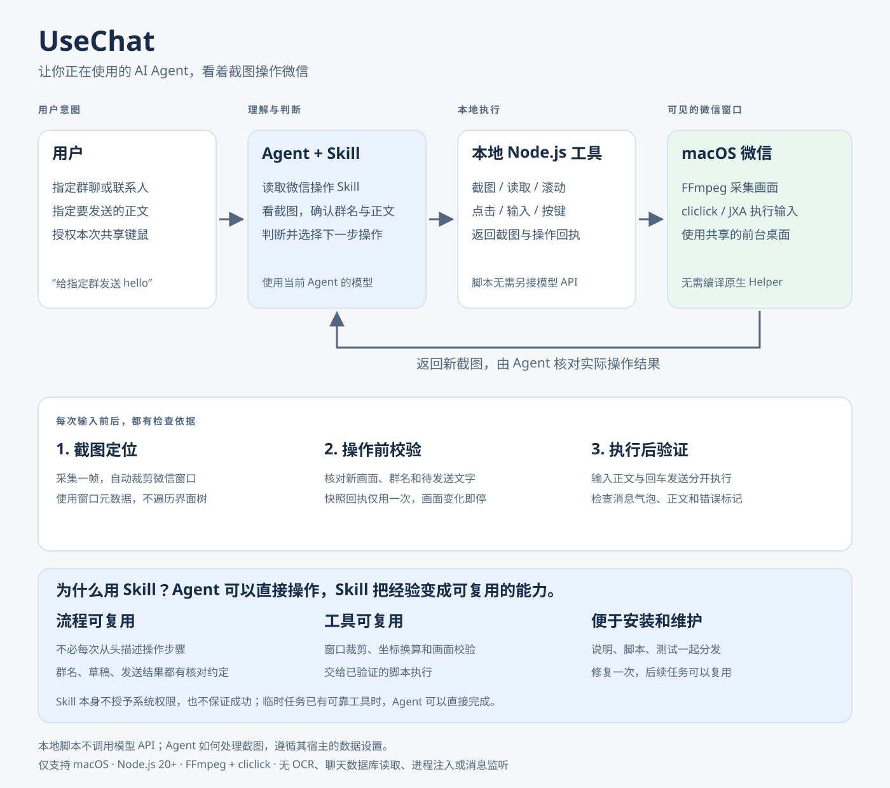

# UseChat

**让 AI Agent 看着截图，使用你电脑上的微信。**

UseChat 现在以 **`wechat-visual` Skill + Node.js 单步工具**分发。Agent 读取 Skill 后，自己看图、识别群聊、点击、输入并验证发送结果；工具不再另行调用模型 API，不需要配置模型 Key 或编译旧版 Helper。

当前支持 **macOS 微信桌面端**。Windows 尚未实现。需要一个能查看本地图片、运行本地命令并加载 Skill 的 Agent；本机已通过 Codex 实际验证。其他宿主请自行验证其 Skill 加载和图像工具。

## 为什么做这个

当你已经在用 Codex 这样的 AI Agent 时，处理微信仍然常常需要自己切换窗口、找群、输入，再回到原任务。UseChat 把这段操作做成可安装的 Skill，让当前 Agent 在你的授权范围内继续完成它。

- **把自然语言变成实际操作**：指定群聊和正文，就能由 Agent 看图定位、输入、发送并检查结果；也可以逐页读取指定群的可见消息，帮助整理上下文。
- **复用已经在用的 Agent**：判断和看图由宿主 Agent 完成，本地脚本只执行单步动作，少一套模型配置和原生 Helper 构建流程。宿主 Agent 自身仍可能产生模型费用。
- **每一步都有可见依据**：操作前检查新截图与保护区域，操作后返回画面，便于核查“点了哪里、输入了什么、是否出现发送气泡”。

它的价值是让 Agent 接上用户正在使用的桌面工作流。当前适合用户主动发起的微信读写与协作，不提供无人值守的群消息监听或批量营销服务。

## Agent 可以直接操作，为什么还要 Skill？

**可以直接操作。** 如果 Agent 已有可用的截图、点击和输入工具，也获得了用户授权，一次临时任务完全可以直接完成。Skill 并不是操作微信的必要条件，也不会赋予模型原本没有的视觉能力或系统权限。

UseChat 选择 Skill，是为了把已经验证过的微信操作经验和本地工具一起交付，方便重复使用：

| 关注点 | Agent 直接操作 | 使用 UseChat Skill |
|---|---|---|
| 操作流程 | 由当次上下文和现有工具决定 | 带有核对群名、保护原草稿、分步输入与发送、检查结果的流程约定 |
| 本地工具 | 复用宿主工具，或临时编写脚本 | 提供窗口裁剪、坐标换算、快照回执和像素校验脚本 |
| 经验复用 | 新会话可能需要重新说明或发现约定 | 操作说明、脚本与测试一起安装，后续可按需读取 |
| 维护更新 | 取决于宿主工具与临时实现 | 同一份仓库集中修复、测试和版本发布 |

例如，“给指定群发送 hello”只有一句话，但执行时仍要处理：微信窗口在哪、截图像素如何对应点击坐标、输入框有没有原草稿、画面是否发生变化，以及发送后是否真的出现了消息气泡。Skill 负责说明这些步骤；脚本负责执行可以确定检查的部分；Agent 仍负责看图和判断。

**Skill 是可安装的操作说明和工具包。** 像素校验等保护来自随包脚本的实现和实际调用，不能仅靠一份说明保证。它不会自动获得微信权限，也不保证零误操作、零模型费用或所有版本兼容。如果你的 Agent 已有可靠的微信操作工具和完整流程，可以直接使用，或只复用本项目中需要的部分。

这种定位也符合 [OpenAI 官方对 Skill 的说明](https://developers.openai.com/cookbook/examples/skills_in_api)：将可重复的操作流程、脚本和资源打包，供 Agent 按需复用。

## 把微信操作中的麻烦沉淀下来

UseChat 采用与人使用桌面软件相同的交互路径：**看当前画面 → 确认目标 → 点击或输入 → 再看结果**。这让 Agent 可以围绕用户真正看到的界面工作，不必依赖微信内部结构树或私有数据接口。Skill 将这条路径中的适配经验和脚本一起保存，后续任务可以复用。

本机实际遇到过：系统截图遗漏微信、普通键入无效、发送按键差异、窗口与焦点变化、滚动落点不对。这些都比“点击发送”四个字复杂。当前 Skill 已记录对应的截图后端选择、授权粘贴与按键方案、坐标换算、画面校验和发送后检查；遇到弹窗时先看清再决定，不能继续使用被遮挡前的坐标。

**“像人一样操作”描述的是交互方式。** 它不代表无法被识别为自动化，也不代表不会触发账号限制。现有证据不足以把上述异常归因于微信反自动化。登录、安全验证或账号限制提示需要交给用户处理。项目沉淀的是可复用的界面操作经验，不承诺绕过检测。

## 架构图



**Agent 负责理解与判断，Skill 约定操作流程，本地工具执行动作，微信画面提供验证依据。** 图中的返回箭头代表每步操作后的新截图；输入前还会重新采集画面，校验标题、草稿和前台身份。工具本身不调用模型 API，宿主 Agent 如何处理截图取决于其数据设置。

最新打包版本见 [GitHub Releases](https://github.com/CosmosShadow/usechat/releases/latest)。下载 `wechat-visual-skill-0.5.2.zip`，解压后将 `wechat-visual` 文件夹放入 Agent 的 skills 目录，依赖和系统授权要求与下文相同。

## 安装

需要 Node.js 20+、Git，以及 FFmpeg 和 cliclick。第三方工具不随项目分发，也不会被脚本静默安装。已有 Homebrew 的用户可以自行安装依赖：

```sh
brew install node ffmpeg cliclick
```

### Codex

将仓库安装为名为 `wechat-visual` 的 Skill：

```sh
mkdir -p ~/.codex/skills
git clone https://github.com/CosmosShadow/usechat.git ~/.codex/skills/wechat-visual
cd ~/.codex/skills/wechat-visual
node scripts/wechat.mjs doctor
```

若该目录已经存在，先核对它的来源；不要覆盖已有 Skill。新开一个 Agent 会话检查 Skill 是否被发现。使用自定义 Codex skills 目录时，将安装路径替换为自己的目录。

其他支持目录式 Skill 的 Agent，可将本仓库放入其 Skill 目录并将文件夹命名为 `wechat-visual`。安装本 Skill 不会替宿主授予系统权限。

macOS 需要向实际运行命令的宿主授予**屏幕录制**和**辅助功能**权限。按系统提示完成后重新执行 `doctor`；其中 `accessibility.trusted` 应为 `true`，还应检查 FFmpeg 和 cliclick 的检测结果。系统截图在部分环境可能无法捕到微信，本机验证使用 FFmpeg AVFoundation。

更新时，在确认安装目录没有个人修改后运行：

```sh
git -C ~/.codex/skills/wechat-visual pull --ff-only
```

卸载时移除自己安装的 `wechat-visual` 文件夹即可。截图与回执独立存于 `~/Library/Caches/wechat-visual/`，可按需清理；不在仓库内。

## 让 Agent 发微信

在 Agent 中说：

> 使用 $wechat-visual，给“三个朋友”微信群发送 hello。允许本次暂时激活微信、共享鼠标键盘并使用剪贴板。

也可以指定读取范围：

> 使用 $wechat-visual，读取“项目讨论”群最近 20 条消息。允许本次暂时激活微信并滚动。不要发送消息。

**群名和消息内容由用户指定。** Agent 看图核对群名；发送前确认输入框没有原有草稿，输入后核对正文，最后单独按 Return。发送后再看截图，确认右侧消息气泡、正文和有无错误标记。工具返回 `posted:true` 只表示投递了输入事件，不能据此声称已发送或对方已读。

共享键鼠会影响前台焦点，需要用户明确同意；剪贴板粘贴也需要对应授权。已有的本次授权可以沿用，遇到群名歧义、原草稿或用户正在操作时暂停核对。

## 工作方式

1. 整屏采集一帧，在本地根据只读窗口元数据自动裁剪出微信窗口。
2. Agent 用图像工具直接看图，给出原始 PNG 像素坐标与标题保护区域。
3. 每次输入前重新截图，验证参考图、保护区域和微信前台身份。变化时拒绝输入。
4. 每步返回新截图供 Agent 检查。输入文字和发送是两个独立动作；不自动重放失败或不确定的操作。

无 OCR、微信 UI 结构树遍历、聊天数据库读取、进程注入、常驻监听或自动回复服务。截图工具本身不调用模型 API；Agent 宿主处理截图时仍遵循该宿主自己的数据与模型配置。

滚动读取通过 `scroll` / `read` 逐页返回重叠截图，由 Agent 根据可见内容计数和整理。无法保证不可见历史完整；附件默认只记录可见名称与状态，不自动下载。

## 命令与开发

先阅读 [SKILL.md](SKILL.md)。在 Skill 安装目录运行：

```sh
node scripts/wechat.mjs --help
node scripts/wechat.mjs doctor
node scripts/wechat.mjs screens
node scripts/wechat.mjs shot --wechat yes
node --test tests/*.test.mjs
```

`shot` 返回图片路径与快照回执。Agent 必须查看图片后，才可使用 `click`、`type`、`key`、`scroll` 或 `read`。输入需要显式 `--allow-shared-input yes`；剪贴板方式还需要 `--method clipboard --allow-clipboard yes`。完整参数、像素保护区域和验证要求见 Skill。

无 npm 运行依赖，无 Swift 编译步骤。`package.json` 为本地开发与打包元数据；当前不提供新的 npm 安装发布。不要使用旧版 npm 包来安装此 Skill。

## 验证与边界

- 28 项本地自动测试通过，覆盖坐标映射、PNG 解码、窗口裁剪、参考快照和输入保护等。
- 本机 macOS 26.4.1 / 微信 4.1.7 已验证截图、群聊可见历史读取、滚动、授权粘贴及恢复剪贴板、Return 发送和发送后气泡检查。
- 本次 Skill 整理前已实际验证用户指定群的 `hello` 发送。测试截图与聊天正文不进入仓库。
- 系统截图在本机无法捕到微信；FFmpeg 路径可用。这只证明本机配置，不代表所有系统版本兼容。
- 使用共享前台输入，不能保证零干扰、零封号或客户端稳定性。支付、附件发送和 Windows 不属于当前已验证功能。

## 旧版迁移

原来的 CLI、SDK、原生 Helper、自配模型和 watch/serve 方案保存在 [`legacy` 分支](https://github.com/CosmosShadow/usechat/tree/legacy)，并以 [`legacy-runtime-2026-11-12` 标签](https://github.com/CosmosShadow/usechat/tree/legacy-runtime-2026-11-12)固定。Git 历史完整保留。

`main` 现在以 Skill 为主，**不兼容旧版 CLI 参数**。安装过旧版 `@shennian/usechat` 或 Helper 的用户，需要按上文另行安装 Skill；新版本不会自动删除旧安装、修改旧配置或接管后台服务。

## 许可与来源

MIT，见 [LICENSE](LICENSE) 与 [NOTICE](NOTICE)。FFmpeg、cliclick 按各自许可单独安装，本仓库不包含第三方二进制。

UseChat 来自[神念](https://shennian.net)的本机微信操作探索。UseChat 提供 Agent 的本地微信 Skill；神念提供跨设备、多 Agent 的连接与控制面。
